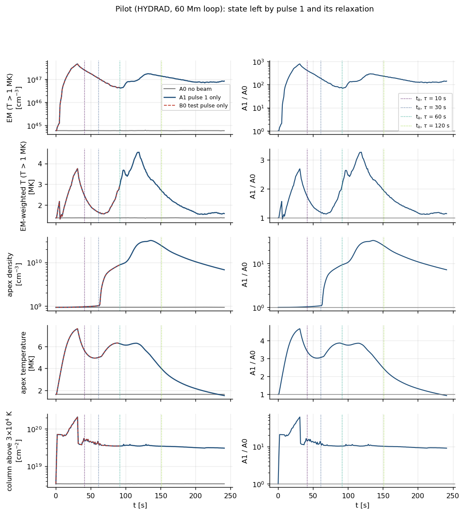
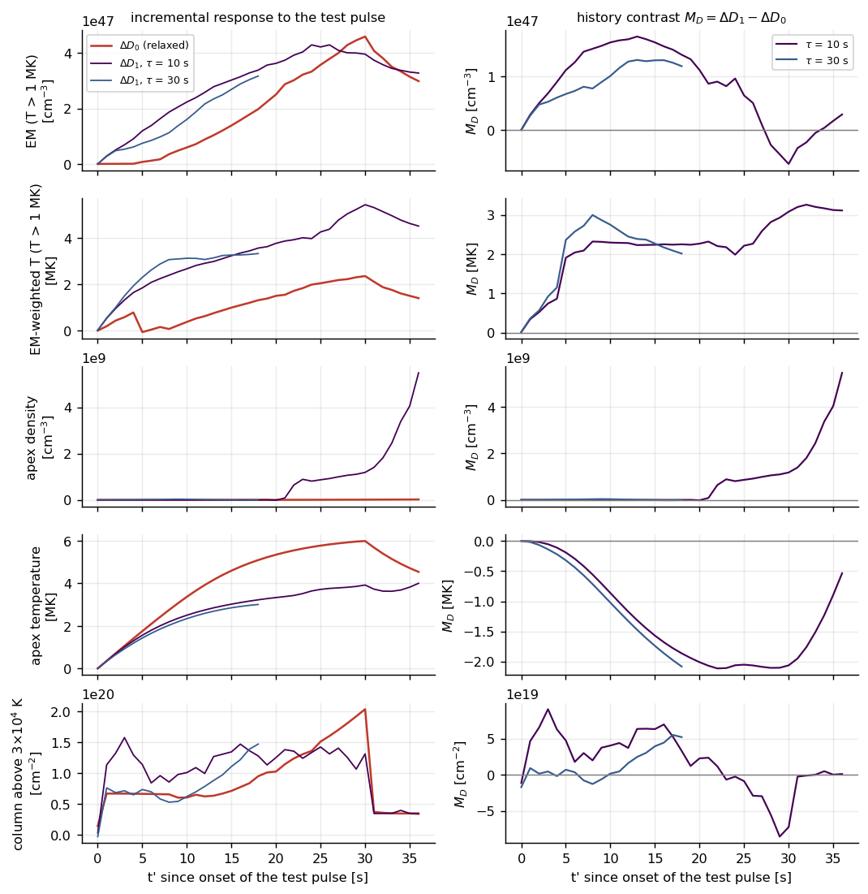
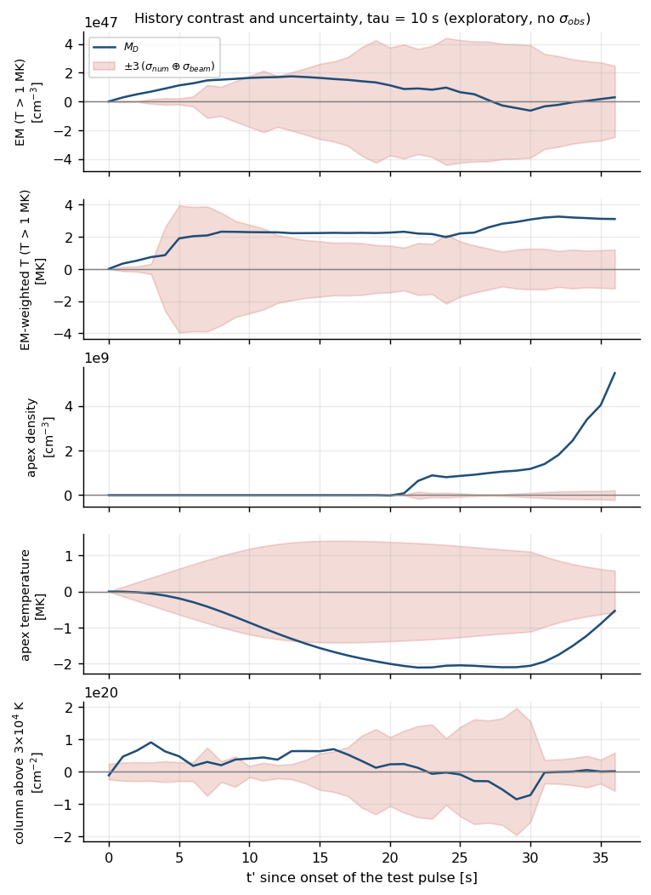
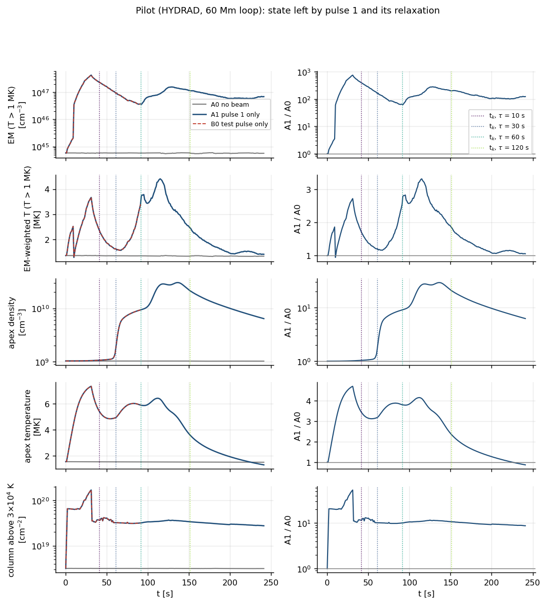
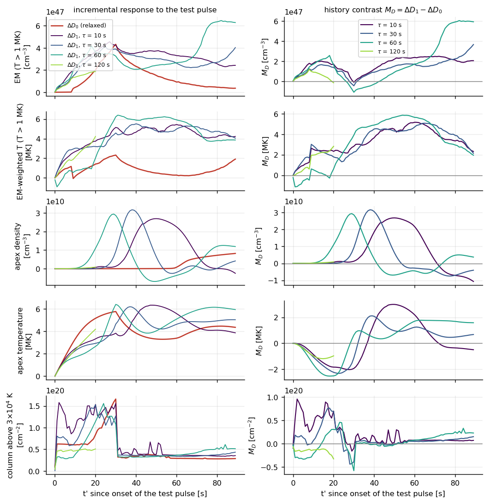
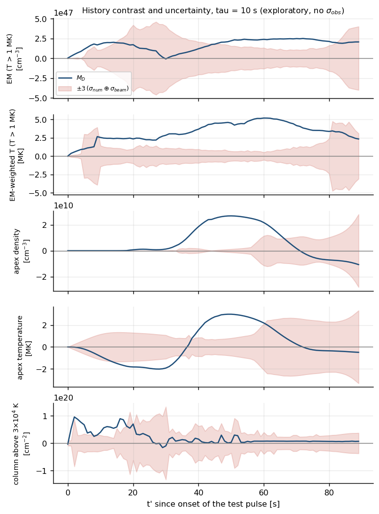

# Core pilot with HYDRAD: numerical stability and first paired-branch results

**Author:** Carlos Alberto Martínez Sibaja

**Date:** 2026-10-05

**Plan:** [methodology v5.1](00_objectives_and_methodology.md), test T3.

**Code:** `scripts/build_hydrad_scratch.sh`, `scripts/hydrad_paired_branches.py`, `scripts/plot_paired_branches.py`, `src/experiments.py` (`build_paired_branches`, `PILOT`), `src/memory_contrast.py`. Run outputs go to `results/` (git-ignored); every number below can be regenerated with those scripts.

**Scope.** HYDRAD as shipped: analytic collisional beam heating with μ₀ = 1, heating of electrons only, optically thin power-law radiative losses, no optically thick chromosphere. The diagnostics are coronal proxies. Nothing here is a chromospheric-line result.

## 1. Pilot configuration

| Quantity | Value |
|---|---|
| Loop | 26 Mm full length, initial conditions of `scripts/hydrad_gate_variants.py` (apex ≈ 1.1 MK, n ≈ 1.6×10⁹ cm⁻³) |
| Pulse 1 and test pulse b | Identical boxcars: 30 s, F = 1.28×10¹⁰ erg cm⁻² s⁻¹, Ec = 20 keV, δ = 5, 0.2 s ramps; pulse 1 starts at t = 1 s |
| Waiting times τ | 10, 30, 60 and 120 s (from the end of pulse 1 to the onset of b) |
| Analysis window | 90 s after the onset of b, 1 s cadence |
| Branches | A0 (no beam), B0 (b only), A1 (pulse 1 only, one run to the longest window), B1 (restart from the A1 profile just before each t_k, with b), A1r (restart check) |

## 2. Numerical stability of the second pulse

### 2.1 What failed

With the shipped solver settings, the first smoke test of B1 at τ = 30 s did not finish within an hour. A diagnostic run showed the following.

- **Before the test pulse.** At t = 60 s, just before the test pulse, pulse 1 had raised the apex density from 1.6×10⁹ to 1.3×10¹¹ cm⁻³ at T ≈ 5 MK. A cold, dense condensation (T ≈ 5×10⁴ K, n ≈ 3×10¹² cm⁻³) had formed in the corona at s ≈ 11.9 Mm, between colliding flows of ±100–190 km s⁻¹.
- **Grid-scale oscillation.** About 2 s after the test pulse started, T_e began to oscillate from cell to cell: dT/ds changed sign 2 607 times in 2 855 cells between s = 8.5 and 13 Mm. The adaptive grid refined to follow the oscillation: 330 cells at t = 62 s, 3 100 at 64 s, 8 500 at 66 s and 31 900 at 69.4 s. The run slowed to about 30 s of wall time per model second.
- **Spurious hot spot.** The apparent hot spot of 13–21 MK in that run is an artefact. With a stable time step, the maximum temperature at t = 64 s is 5.6 MK.

### 2.2 Variants from the same state

Each variant restarts B1 from the same t = 60 s state and runs to t = 65–66 s. Only numerical settings of `HYDRAD/source/config.h` change.

| Variant | Change | Wall time | Cells at the end | Outcome |
|---|---|---|---|---|
| base | shipped settings | 592 s | 7 579 | Oscillation and runaway refinement |
| lin | linear interpolation when refining | 490 s | 7 693 | Same |
| visc | artificial viscosity (relative time scale 10) | 641 s | 6 278 | Same |
| lin_visc | both | 523 s | 7 260 | Same |
| lin_nocons | linear interpolation, no conservation correction | 8 s | 209 | Smooth, but within 1 s the loop gains 4–6 % of its mass, loses 7 % of its energy, and the apex density changes by +31 %. Rejected |
| rad001 | SAFETY_RADIATION 0.1 → 0.01 | 8 s | — | NaN at t = 65 s |
| cond05 | SAFETY_CONDUCTION 1.0 → 0.5 | 41 s | 1 786 | Smooth to 64 s, refinement growing again at 65 s: marginal |
| **cond02** | **SAFETY_CONDUCTION 1.0 → 0.2** | **21 s** | **325** | **Smooth, conservation kept** |
| cond02_rad001 | both | 21 s | 323 | Smooth |
| adv05_cond05 | SAFETY_ADVECTION and SAFETY_CONDUCTION 0.5 | 10 s | 335 | Smooth |
| frac_2_4 | refine at 20–40 % instead of 10–20 % differences | 2 s | 210 | Smooth, but changes the resolution |

**Diagnosis.** The explicit thermal-conduction step becomes unstable when the beam heats the dense, structured corona left by pulse 1. Interpolation and viscosity do not cure it; a smaller conduction time step does, without touching conservation.

**Setting adopted for the next step.** `SAFETY_CONDUCTION = 0.2` (`scripts/build_hydrad_scratch.sh --set SAFETY_CONDUCTION=0.2`).

### 2.3 A second problem: coronal condensations after pulse 1

The full pilot with `SAFETY_CONDUCTION = 0.2` from t = 0 failed for a different reason. Branch A1, which has no second pulse, reached NaN at t = 68 s; B1 at τ = 30 s did the same at t = 67 s. The cause is not the test pulse.

- **Condensations.** The evaporation flows from the two legs (up to ~300 km s⁻¹) collide near the apex. The compressed plasma cools catastrophically: by t = 60–67 s there are two coronal condensations at s ≈ 11.5–11.8 and 14.0–14.5 Mm, with T ≈ 2×10⁴ K (the radiation floor) and n ≈ 2–3×10¹² cm⁻³. They lie symmetrically about the apex at 13 Mm. A1 failed right after they formed.
- **Interpretation.** Cooling at these densities takes seconds, so the condensation is plausible in a symmetric 1D model. Its exact timing is sensitive to numerical settings: with the shipped settings, the same branch survived to 151 s in the first smoke test.

This is part of the history left by pulse 1. Any memory result in this loop depends on how the model treats condensations. HYDRAD settings that let the relaxation phase run to the longest window (241 s) are being tested in Section 2.5.

### 2.4 The earlier high-flux failures with the stable conduction step

The gate variants of [docs/06](06_usefulness_tests.md) that had failed were rerun with `SAFETY_CONDUCTION = 0.2`, up to the onset of a second pulse:

| Variant | Before (shipped settings) | With SAFETY_CONDUCTION = 0.2 |
|---|---|---|
| V2: 60 Mm, F = 1.3×10¹⁰, 30 s pulse | NaN at t ≈ 21–25 s | **Clean to t = 51 s** (169 s wall). Coronal column 3.4×10¹⁸ → 4.3×10¹⁹ cm⁻² (56 % of the 20 keV stopping column); toy spectral bias Δδ = −0.23 |
| V3: 60 Mm, F = 5×10¹⁰, 10 s | NaN at t ≈ 6–7 s | Still NaN before t = 30 s |
| V4: 26 Mm, F = 5×10¹⁰, 10 s | NaN at t ≈ 6–7 s | Still NaN before t = 30 s |

The stable conduction step therefore extends the domain to a 30 s pulse in a 60 Mm loop. It does not cure the failures at 5×10¹⁰ erg cm⁻² s⁻¹, which have another cause.

### 2.5 Settings for the relaxation phase

Branch A1 (pulse 1 only) was run from t = 0 to 170 s. All variants use `SAFETY_CONDUCTION = 0.2`; the last column counts the coronal cells below 10⁵ K, i.e. the size of the condensations.

| Variant | Loop | Additional settings | Result | Wall time | Coronal cells < 10⁵ K (max) |
|---|---|---|---|---|---|
| c02_zero5e3 | 26 Mm | radiation switch-off interval 500 → 5 000 K | NaN at 67 s | — | 148 |
| c02_lin | 26 Mm | linear restriction | NaN at 69 s | — | 141 |
| c02_r001 | 26 Mm | SAFETY_RADIATION 0.01 | NaN at 75 s | — | 146 |
| **c02_r001_lin** | 26 Mm | SAFETY_RADIATION 0.01 + linear restriction | **clean to 170 s** | 1 305 s | 162 |
| c02_r0001 | 26 Mm | SAFETY_RADIATION 0.001 | clean to 170 s | 2 594 s | 147 |
| **c02_L60** | 60 Mm | — | **clean to 170 s** | 679 s | 87 |

Condensations form in every case, including the 60 Mm loop. Survival depends on how radiation and refinement are handled once they form.

**Next step.** The full paired pilot is run with the two cheapest surviving settings:

- 26 Mm with c02_r001_lin;
- 60 Mm with c02_L60.

If both give a consistent M_D, the numerical treatment is not driving the result. Differences between them are physical (loop length) as well as numerical, so a numerical-error estimate within one loop (test T4) is still needed.

## 3. Validity: the loop loses mass after ~80 s

Both full pilots finished every branch except B1 at τ = 120 s in 60 Mm, which was stopped after slowing to ~4.5 min per model second. B1 at τ = 30 s in 26 Mm reached NaN at t = 67 s. The total hydrogen column of the loop, which should stay constant between closed footpoints, is not conserved:

| Run (60 Mm) | Mass within 1 % until | Mass change at the end of the run |
|---|---|---|
| A0 (no beam) | 241 s, the whole run | +0.1 % |
| B0 (test pulse only) | 83 s | ~0 % at 91 s, after exceeding 1 % in between |
| A1 (pulse 1 only) | 83 s | +17 % at 241 s |
| B1, τ = 10 / 30 / 60 s | 77 / 79 / 98 s | −45 / −46 / −16 % |

The 26 Mm loop behaves the same way, from t ≈ 71–73 s, losing up to 93 % of the loop mass in B1.

**Mechanism.** The loss starts when the adaptive grid reaches the fixed boundary cells at the footpoints. Between t = 85 and 100 s, 28 % of the left chromosphere disappeared with negligible flow at the boundary.

**Cause.** The shipped initial conditions have a 5 Mm isothermal chromosphere at 2×10⁴ K, with n ≈ 10¹¹ cm⁻³ at its top and ≈ 1.4×10¹³ cm⁻³ at its base. This thin reservoir is not designed for flare heating; the HYDRAD guide (Section 5.2.5) recommends the optically thick VAL-C chromosphere for flare models.

**Consequence.** `scripts/hydrad_paired_branches.py` evaluates contrasts only while all four branches keep the loop mass within 1 % (`MASS_TOL`, set before looking at contrasts). Only the impulsive response to the test pulse survives this mask. The waiting-time scan beyond τ ≈ 30 s is not accessible with this setup.

## 4. Results in the mass-conserving windows

### 4.1 60 Mm loop (`SAFETY_CONDUCTION = 0.2`)

In both figures, the A1 evolution after t ≈ 83 s (a second rise of the EM-weighted temperature and the apex density without any beam) falls in the invalid part and is not used.

**State of the loop at t_k.** Pulse 1 has not relaxed at either τ = 10 s or τ = 30 s: the coronal column is still 11–14 times that of A0. All three variables of Section 3.4 fail the 5 % tolerance.

**Contrast within the valid windows** (τ = 10 s, t′ ≤ 36 s; τ = 30 s, t′ ≤ 18 s). ΔD₀ is the response to the test pulse on the relaxed atmosphere, ΔD₁ the response with pulse-1 history:

| Diagnostic | t′ | ΔD₀ | ΔD₁ | M_D = ΔD₁ − ΔD₀ |
|---|---|---|---|---|
| EM of T > 1 MK plasma, τ = 10 s | 5 s | 7.3×10⁴⁵ cm⁻³ | 1.2×10⁴⁷ | +1.1×10⁴⁷ |
| | 15 s | 1.4×10⁴⁷ | 3.0×10⁴⁷ | +1.6×10⁴⁷ |
| | 30 s (end of pulse) | 4.6×10⁴⁷ | 4.0×10⁴⁷ | −0.6×10⁴⁷ |
| EM-weighted T (T > 1 MK), τ = 10 s | 5 s | −0.06 MK | +1.9 MK | +1.9 MK |
| | 30 s | +2.4 MK | +5.4 MK | +3.1 MK |
| Apex temperature, τ = 10 s | 15 s | +4.6 MK | +3.0 MK | −1.6 MK |
| | 30 s | +6.0 MK | +3.9 MK | −2.1 MK |
| EM of T > 1 MK plasma, τ = 30 s | 15 s | 1.4×10⁴⁷ | 2.7×10⁴⁷ | +1.3×10⁴⁷ |
| Apex temperature, τ = 30 s | 15 s | +4.6 MK | +2.9 MK | −1.7 MK |

**Reading.** The test beam enters a corona already filled by pulse 1, which stops part of it there (coronal column 4×10¹⁹ cm⁻² at t_k).

- **Hot emission rises at once.** The hot emission measure and its EM-weighted temperature respond immediately: +1.9 MK within 5 s, against no change on the relaxed atmosphere, where the corona must first be filled by evaporation.
- **The apex warms less.** The same energy goes into many more particles, so the apex warms about 2 MK less.
- **The EM responses converge.** By the end of the pulse they agree within ~15 %, and their sign reverses.

In this model, then, the independent-pulse approximation misrepresents the timing and temperature of the impulsive coronal response, more than its time-integrated emission measure.

**Size of the contrast.** For the emission measure, the restart error (A1 restarted without b, compared with A1) is 3.6×10⁴⁵ cm⁻³, 2 % of the peak |M|. It is 2×10⁴ K for the EM-weighted temperature and 8×10³ K for the apex temperature. The contrasts are therefore far above this part of σ_num. The time-step part of σ_num and σ_beam are in Section 5. σ_obs has not been set, so no detection decision is made.

### 4.2 26 Mm loop (`SAFETY_CONDUCTION = 0.2`, `SAFETY_RADIATION = 0.01`, linear restriction)

Valid windows: τ = 10 s up to t′ = 29 s; τ = 30 s only up to t′ = 5 s, because B1 failed at t = 67 s.

The signs agree with the 60 Mm loop: the hot EM rises faster with history, the apex warms less. The amplitudes are larger: at τ = 10 s and t′ = 15 s, ΔD₁ is 1.1×10⁴⁸ cm⁻³ against ΔD₀ = 1.7×10⁴⁷.

Point diagnostics at the apex jump by orders of magnitude when a condensation passes through the apex cell, so they are not usable in this loop. The restart error of the coronal column is 13 % of its contrast.

**Use.** The 26 Mm results are a consistency check, not a primary result.

## 5. Numerical error

The four branches of τ = 10 s in the 60 Mm loop were repeated with half the conduction time step (`SAFETY_CONDUCTION = 0.1`). A0 and B0 started from the initial atmosphere; A1 and B1 restarted from the pilot's A1 just before t_k (`scripts/hydrad_numerical_error.py`). Each run was stopped once it covered the valid window, t′ ≤ 36 s.

| Diagnostic | max \|M(0.1) − M(0.2)\| | Pilot max \|M\| | Ratio |
|---|---|---|---|
| Apex density | 7.3×10⁷ cm⁻³ | 5.5×10⁹ | 75 |
| Apex temperature | 0.035 MK | 2.1 MK | 60 |
| EM of T > 1 MK plasma | 2.5×10⁴⁶ cm⁻³ | 1.75×10⁴⁷ | 6.9 |
| EM-weighted T (T > 1 MK) | 0.91 MK | 3.3 MK | 3.6 |
| Coronal column above 3×10⁴ K | 4.4×10¹⁹ cm⁻² | 9.1×10¹⁹ | 2.1 |

The apex contrasts and the emission measure contrast are robust to the time step. The EM-weighted temperature is marginal at 3σ_num. The coronal column is not robust: its 3×10⁴ K threshold sits on the condensations and on the radiation floor at 2×10⁴ K.

Spatial resolution, i.e. the refinement thresholds, has not been varied yet. These numbers are therefore a lower bound on σ_num.

### 5.1 Beam uncertainty and where the contrast stands out

B0 was repeated with the test beam varied one parameter at a time, within relative uncertainties typical of a STIX fit. The values follow the first-burst fit of Collier et al. (2024): electron rate ±12 %, cutoff ±4 %, spectral index ±0.1 (`scripts/hydrad_beam_error.py`). σ_beam(t′) is the largest change of ΔD₀ among these variants at each t′.

`scripts/pilot_uncertainty.py` compares |M_D(t′)| with 3 (σ_num ⊕ σ_beam) at each t′. This is exploratory: σ_obs is not included, and the σ values were measured after the contrasts. It is not the pre-registered decision of the plan.

| Diagnostic (60 Mm, τ = 10 s) | Peak σ_beam | t′ where \|M\| > 3 (σ_num ⊕ σ_beam) |
|---|---|---|
| EM of T > 1 MK plasma | 1.5×10⁴⁷ cm⁻³, about the size of max \|M\| | 1–9 s |
| EM-weighted T (T > 1 MK) | 1.1 MK | 0–3, 12–23 and 25–36 s |
| Apex temperature | 0.47 MK | 14–35 s |
| Apex density | 1.6×10⁶ cm⁻³ | 9–18 and 20–36 s |
| Coronal column above 3×10⁴ K | 5.3×10¹⁹ cm⁻² | 1–5 and 10–16 s, fragmented; not usable |

**Reading.** Varying the beam by its uncertainty changes the late emission measure as much as the history does: around the end of the pulse, the integrated hot emission measure cannot tell a re-struck loop from a slightly stronger beam on a fresh one. Two parts of the response remain distinguishable from beam and numerical uncertainty:

- **The onset of the hot emission.** In the first ~9 s, history makes the hot EM appear at once instead of after the evaporation delay.
- **The apex heating.** From t′ ≈ 14 s on, the re-struck apex is ~2 MK cooler.

Whether these survive σ_obs depends on the instrument that would measure them; that is the next quantity to fix.

## 6. Deeper chromosphere

Branch A1 in the 60 Mm loop was rerun with the isothermal chromosphere deepened from 5 Mm to 8 and 10 Mm per footpoint (`SAFETY_CONDUCTION = 0.2`):

| Chromosphere | Initial loop column | Loop mass at t = 83 / 100 / 120 s | Boundary cell refined? |
|---|---|---|---|
| 5 Mm (shipped) | 3.7×10²¹ cm⁻² | outside 1 % from 83 s; −19 % at 120 s | yes, from ~85 s |
| 8 Mm | 7.3×10²² | +0.02 / +0.03 / +0.04 % | no |
| 10 Mm | 4.7×10²³ | +0.02 / +0.03 / +0.04 % (to 113 s) | no |

Both runs stayed clean to the point where they were stopped (123 and 113 s). With the deeper reservoir, the moving transition region and the falling condensations never bring the adaptive grid to the boundary cells, and mass is conserved. The 1 % mass tolerance remains sensitive: a loss as large as in the 5 Mm case (~10²¹ cm⁻²) would be 1.4 % of the 8 Mm loop column.

**Adopted.** The full paired pilot was rerun in the 60 Mm loop with the 8 Mm chromosphere (`--chromosphere-cm 8e8`, label `L60_chr8_c02`).

### 6.1 Full pilot with the 8 Mm chromosphere

**Validity.**

- **Mass.** Every branch conserves the loop mass, with a change of at most 0.5 % at the end of A1 and well below 1 % elsewhere.
- **Windows.** The windows cover the full 89 s for τ = 10, 30 and 60 s.
- **τ = 120 s is invalid.** B1 developed the grid-scale T_e oscillation of Section 2 as soon as its test pulse started (t ≈ 152 s): ~99 % of cells oscillating, 30 000 cells and spurious 45–52 MK. A continuation was stopped. The other branches stay below 40 % oscillating cells with a few hundred cells. The analysis now also ends a window at the first profile with more than 60 % oscillating cells (`OSC_MAX`), so this branch is excluded automatically. Rerunning it needs a smaller conduction step (0.1).
- **Cost.** About 2 h of wall time on 6 cores, dominated by A1 and by the B1 branches during the test pulse.

**The loop does not relax within 120 s.** A1 relative to A0:

| t (τ) | EM of T > 1 MK | Apex density | Apex temperature | Coronal column |
|---|---|---|---|---|
| 41 s (10 s) | 406 | 1.0 | 3.5 | 11.6 |
| 61 s (30 s) | 161 | 1.8 | 3.2 | 10.2 |
| 91 s (60 s) | 66 | 9.1 | 3.8 | 10.1 |
| 151 s (120 s) | 201 | 20.9 | 2.4 | 10.7 |
| 241 s (end) | 124 | 6.3 | 0.9 | 8.7 |

The 5 % relaxation criterion fails at every τ, so τ* lies beyond 120 s for this loop and beam.

**A second episode without a beam.** Between t ≈ 85 and 130 s, A1 shows a second rise of the hot EM, of the EM-weighted temperature (to 4.4 MK) and of the apex temperature (to 6.4 MK), while the apex density climbs to 3×10¹⁰ cm⁻³. No energy is being injected. The loop mass is conserved, so this is not the boundary artefact of Section 3. The likely cause is the dynamics of the symmetric 1D loop: the evaporation flows of the two legs collide and rebound around the apex. This is a property of the model, and it remains to be checked against numerical resolution.

**Contrast** (ΔD₀ / ΔD₁ / M_D):

| Diagnostic | τ | t′ = 5 s | t′ = 15 s | t′ = 30 s | t′ = 60 s | t′ = 89 s |
|---|---|---|---|---|---|---|
| EM of T > 1 MK [10⁴⁷ cm⁻³] | 10 s | 0.01 / 1.15 / +1.14 | 1.05 / 3.01 / +1.96 | 4.33 / 4.24 / −0.08 | 0.92 / 3.31 / +2.39 | 0.36 / 2.43 / +2.06 |
| | 60 s | 0.01 / 0.87 / +0.86 | 1.05 / 3.30 / +2.25 | 4.33 / 3.26 / −1.07 | 0.92 / 2.66 / +1.74 | 0.36 / 6.29 / +5.92 |
| EM-weighted T [MK] | 10 s | 0.9 / 1.9 / +1.0 | 0.9 / 3.3 / +2.4 | 2.3 / 5.2 / +2.8 | 0.3 / 5.4 / +5.2 | 1.9 / 4.2 / +2.3 |
| Apex temperature [MK] | 10 s | 1.7 / 1.6 / −0.2 | 4.5 / 3.0 / −1.5 | 5.8 / 3.8 / −1.9 | 3.4 / 5.6 / +2.2 | 4.4 / 3.9 / −0.5 |
| | 30 s | 1.7 / 1.4 / −0.4 | 4.5 / 2.7 / −1.8 | 5.8 / 4.7 / −1.1 | 3.4 / 4.6 / +1.2 | 4.4 / 5.0 / +0.7 |

**Reading.** With a conserved loop mass and a full window, the picture of Section 4.1 holds and extends.

- **During the test pulse** (t′ ≤ 30 s):
  - The hot EM appears at once, without the evaporation delay of the fresh loop.
  - The apex heats 1.5–2.4 MK less.
  - The EM-weighted temperature is 1–3 MK higher.
  - By the end of the pulse the hot EM of the two histories agrees within ~25 %.
- **After the pulse:**
  - The re-struck loop stays hotter (EM-weighted T higher by 2–5 MK) and keeps 2–17 times the hot EM of the fresh response.
  - It holds more hot plasma and is still sloshing.
- **Waiting time.** None of these contrasts decreases from τ = 10 s to 60 s.

The point diagnostics at the apex (density and temperature) oscillate with the arrival of the evaporation fronts and with the sloshing; their sign changes with t′ and τ. The integrated EM and EM-weighted temperature are more stable.

### 6.2 Uncertainty with the 8 Mm chromosphere (τ = 10 s, full 89 s window)

Same procedure as Section 5.1: half the conduction time step for σ_num, and six beam variants for σ_beam.

| Diagnostic | σ_num (peak) | σ_beam (peak) | Max \|M\| | t′ where \|M\| > 3 (σ_num ⊕ σ_beam) |
|---|---|---|---|---|
| EM of T > 1 MK plasma | 2.8×10⁴⁶ cm⁻³ | 1.5×10⁴⁷ | 2.5×10⁴⁷ | 0–14 and 45–82 s |
| EM-weighted T (T > 1 MK) | 0.25 MK | 1.6 MK | 5.2 MK | 1–4 and 10–80 s |
| Apex temperature | 0.32 MK | 1.1 MK | 3.0 MK | 14–34 and 38–60 s |
| Apex density | 2.9×10⁹ cm⁻³ | 9.4×10⁹ | 2.7×10¹⁰ | 13–66 s |

**What survives the beam and numerical errors.**

- **Hot EM:** its immediate onset, and the extra hot plasma kept after the pulse.
- **Apex temperature:** about 2 MK cooler during the pulse.
- **EM-weighted temperature:** higher for most of the window.

Around the end of the pulse (t′ ≈ 15–45 s), a beam changed by its fit errors moves the emission measure as much as history does. The time-step σ_num also covers the second episode of A1 (t ≈ 85–130 s), and stays small there. As in Section 5.1, this is exploratory: σ_obs is missing, and the σ values were measured after the contrasts.

## 7. Consequences for review R1

To be completed after Sections 5 and 6.
