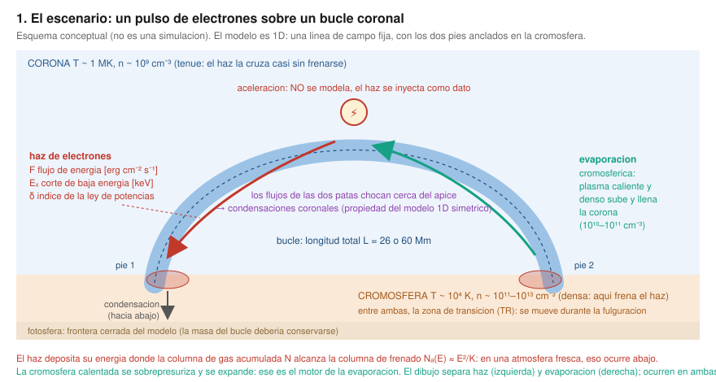
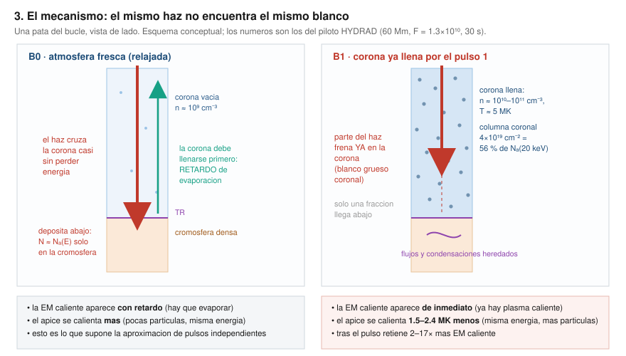
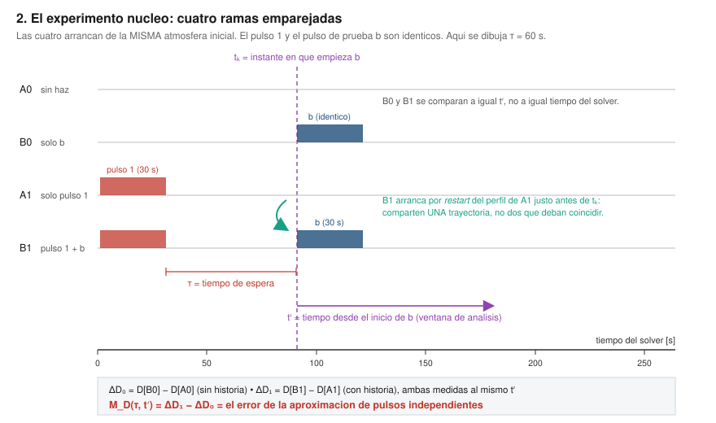
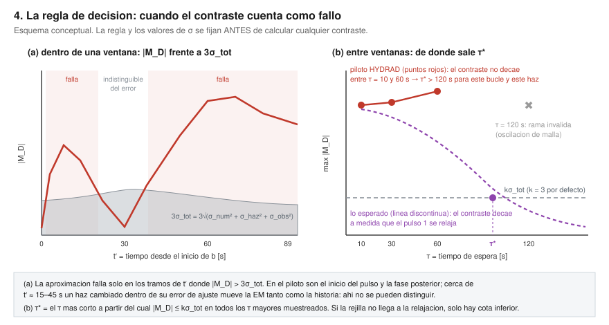
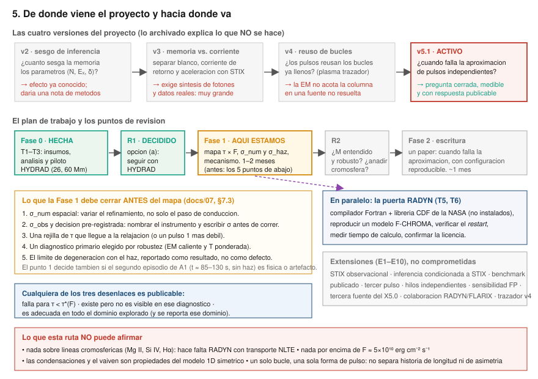

# Guía de conceptos: entender el proyecto desde cero

**Autor:** Carlos Alberto Martínez Sibaja · **Versión del plan que describe:** v5.1 (2026-10-05) · **Fecha de la guía:** 2026-10-12

Esta guía es un **documento de apoyo en español**, no una fuente autoritativa. El plan oficial es
[docs/00_objectives_and_methodology.md](00_objectives_and_methodology.md) y los resultados oficiales están en
[docs/07_core_pilot_hydrad.md](07_core_pilot_hydrad.md). Si algo aquí contradice a esos documentos, ellos mandan.
La documentación colaborativa del repositorio se mantiene en inglés ([SKILL.md](../skills/stix-rhd-memory/SKILL.md)).

Está pensada para leerse de arriba abajo sin saber nada previo: primero la física, después el problema,
después el experimento, después lo que ya se midió, los retos, la historia de los cambios y hacia dónde va.

**Índice**

1. [La física mínima](#1-la-física-mínima-qué-pasa-cuando-una-fulguración-golpea-un-bucle)
2. [El problema: la aproximación de pulsos independientes](#2-el-problema-la-aproximación-de-pulsos-independientes)
3. [La pregunta exacta del proyecto](#3-la-pregunta-exacta-del-proyecto)
4. [El experimento: cuatro ramas emparejadas](#4-el-experimento-cuatro-ramas-emparejadas)
5. [Qué se mide y cómo se decide](#5-qué-se-mide-y-cómo-se-decide)
6. [Las herramientas y qué permite afirmar cada una](#6-las-herramientas-y-qué-permite-afirmar-cada-una)
7. [Lo que ya se sabe: el piloto](#7-lo-que-ya-se-sabe-el-piloto-hydrad)
8. [Los retos](#8-los-retos-reales)
9. [Cómo cambió el proyecto (v2 → v5.1)](#9-cómo-cambió-el-proyecto-v2--v51)
10. [Hacia dónde va y qué se espera](#10-hacia-dónde-va-y-qué-se-espera)
11. [Cómo correrlo](#11-cómo-correrlo)
12. [Glosario y mapa de documentos](#12-glosario-y-mapa-de-documentos)

---

## 1. La física mínima: qué pasa cuando una fulguración golpea un bucle



El escenario es un **bucle coronal**: un tubo de campo magnético con los dos pies anclados en la cromosfera.
El modelo es **1D**: se sigue el plasma a lo largo de esa línea de campo, que se supone fija (no es MHD, el campo no evoluciona).

La secuencia es siempre la misma:

1. **Aceleración (no se modela).** En algún punto alto se aceleran electrones. En este proyecto eso *no* se calcula:
   el haz **se inyecta como dato**, descrito por tres números —
   `F` el flujo de energía (erg cm⁻² s⁻¹), `Ec` la energía de corte (keV) y `δ` el índice de la ley de potencias —
   más una duración. Este es el contenido de `beam_heating_model.cfg` y de `src/beam_tables.py`.

2. **Transporte y frenado.** Los electrones bajan por el tubo y pierden energía por colisiones de Coulomb.
   La variable natural no es la distancia sino la **columna** `N` (partículas por cm² atravesadas): `dE/dN = −K/E`.
   Integrando, un electrón de energía `E` se frena tras recorrer la **columna de frenado**

   ```text
   N_c(E) ≈ E² / (2K)        →  a 20 keV, N_c ≈ 7.7×10¹⁹ cm⁻²
   ```

   `K` depende del estado del gas: es ~2.8 veces mayor en gas ionizado que en neutro (Kontar, Brown & McArthur 2002),
   así que en plasma ionizado el mismo electrón se frena tras atravesar una columna **menor**.
   **Dónde deposita el haz su energía no es una propiedad del haz: es una propiedad del blanco.**

3. **Evaporación cromosférica.** La corona en reposo (n ~ 10⁹ cm⁻³) apenas suma columna, así que el haz llega hasta
   la cromosfera densa (n ~ 10¹¹–10¹³ cm⁻³) y la calienta ahí. Esa capa se sobrepresuriza y se expande:
   plasma caliente y denso **sube y llena la corona** (evaporación), mientras una parte más fría baja (condensación).

4. **El bucle queda cambiado.** Después de un pulso la corona tiene más densidad, más temperatura, flujos de
   cientos de km/s, la zona de transición desplazada y un estado de ionización distinto. Eso es la **memoria atmosférica**.

**El punto clave:** tras un pulso fuerte la columna coronal del piloto sube a ~4×10¹⁹ cm⁻², es decir **~56 % de la
columna de frenado a 20 keV**. La corona deja de ser transparente para el haz. Un segundo pulso idéntico ya no
encuentra el mismo blanco.

### Los cuatro canales de memoria

| Canal | Qué cambia | ¿Lo ve HYDRAD? |
|---|---|---|
| **Densidad / columna coronal** | El haz frena más arriba (blanco grueso coronal) | Sí |
| **Temperatura** | Emisión térmica, conducción, pérdidas radiativas | Sí |
| **Ionización** | `K` del frenado; la recombinación real es fuera de equilibrio y lenta | **No** (supone n_e = n_H); lo hace RADYN |
| **Flujos y condensaciones** | Perfiles Doppler, vaivén del plasma, dónde está la TR | Sí, pero son propiedades del modelo 1D simétrico |

---

## 2. El problema: la aproximación de pulsos independientes



Casi todos los modelos de fulguraciones hacen lo mismo: **calientan cada hebra una sola vez, partiendo de una
atmósfera relajada**, y suman las respuestas. Eso es la **aproximación de pulsos independientes**:

> la respuesta a un pulso se calcula sobre la atmósfera inicial y se añade a lo que dejaron los pulsos anteriores.

Un modelo *multithread* que pone cada pulso en una hebra nueva hace exactamente la misma suposición cada vez que,
en realidad, la hebra vuelve a ser golpeada. La usan, entre otros, Rubio da Costa et al. (2016) y Reep et al. (2018).

**Por qué podría fallar.** Si la corona ya está llena:

- parte del haz **frena en la corona**, no en la cromosfera;
- la misma energía se reparte entre **muchas más partículas**, así que el ápice se calienta *menos*;
- la emisión caliente **aparece de inmediato**, porque no hay que esperar a evaporar nada.

Nada de esto es exótico: es el mismo haz con un blanco distinto. La pregunta no es *si* existe, sino **cuánto vale
y cuándo importa** comparado con los errores con los que realmente se mide.

---

## 3. La pregunta exacta del proyecto

> **¿Cuándo tratar cada pulso de electrones como si hubiera golpeado la atmósfera inicial relajada tergiversa la
> respuesta a un pulso posterior más allá de las incertidumbres de haz, numéricas y observacionales de un
> diagnóstico elegido?**

Tres detalles que cambian todo y conviene memorizar:

- **"más allá de las incertidumbres"**: no basta con que el efecto exista; tiene que superar el error con el que
  se mediría. Por eso hay una regla de decisión fijada *antes* de mirar los resultados.
- **"de un diagnóstico elegido"**: la respuesta depende de *qué* se mira. El efecto puede ser enorme en el estado
  del plasma e invisible en el observable.
- **"mismo bucle golpeado de nuevo"** es el **escenario de modelado** del núcleo, no una afirmación sobre ninguna
  fulguración observada. Que dos pulsos iluminen el mismo pie no prueba que sea la misma hebra.

El objetivo comprometido (dos pulsos idénticos, un bucle, un diagnóstico primario) es:

1. medir el contraste de historia `M_D` con ramas emparejadas, en función del tiempo de espera `τ` y del flujo `F`;
2. **explicarlo** con el estado que dejó el primer pulso;
3. decir en qué rango de `τ` la aproximación falla o es adecuada.

---

## 4. El experimento: cuatro ramas emparejadas



El truco del diseño es que **no se puede comparar un pulso con otro directamente**: el segundo ocurre sobre un
fondo que el primero dejó caliente y brillante. Hay que restar ese fondo. Por eso se corren cuatro simulaciones
desde la misma atmósfera inicial, con el pulso 1 y el pulso de prueba `b` **idénticos**:

| Rama | Qué contiene | Para qué sirve |
|---|---|---|
| **A0** | sin haz (solo calentamiento de fondo) | referencia: cómo evoluciona el bucle sin que pase nada |
| **B0** | solo el pulso `b`, sobre la atmósfera relajada | la respuesta "de libro de texto" |
| **A1** | solo el pulso 1 | el fondo que deja el primer pulso |
| **B1** | pulso 1, espera `τ`, luego `b` | el caso real: segundo golpe con historia |

Y entonces, midiendo todo **al mismo `t′`** (tiempo desde el inicio de `b`):

```text
ΔD₀(t′) = D[B0] − D[A0]      respuesta de b sin historia
ΔD₁(t′) = D[B1] − D[A1]      respuesta de b con historia
M_D(τ, t′) = ΔD₁ − ΔD₀       ← el error de la aproximación de pulsos independientes
```

`M_D` es un **contraste causal dentro del modelo**: compara dos mundos que solo difieren en si hubo un pulso
anterior. No supone que las emisiones se sumen linealmente, y no se divide nunca por `ΔD₀` (que puede pasar por cero).

**Reglas que hacen válido el contraste** (si se rompen, el número no significa nada):

- mismo solver, misma configuración, misma malla y misma cadencia en las cuatro ramas; comparación a `t′` igual y
  perfiles sobre una coordenada común de masa o columna;
- **A1 y B1 deben ser idénticas antes de `t_k`**. En la práctica B1 no se corre desde cero: **se reinicia (`restart`)
  desde el perfil de A1 justo antes del pulso de prueba**, así comparten literalmente una trayectoria.
  (Con RADYN esto es obligatorio además por otro motivo: el *spline* de `ftab.dat` puede acoplar filas a ambos lados de `t_k`.)
- para diagnósticos derivados de perfiles (centroides Doppler, anchuras): se sintetiza el perfil en cada rama,
  se mide `D`, y *después* se forma el contraste.

**La relajación se juzga aparte.** Que el pulso 1 "ya se haya relajado" se decide comparando el **estado** de A1
con A0 (columna coronal, densidad y temperatura del ápice, masa por encima de la TR, poblaciones atómicas),
con tolerancias del 5 % fijadas de antemano. **Nunca** se deduce de que `M_D → 0`: eso sería usar como criterio
justo lo que el experimento quiere medir.

---

## 5. Qué se mide y cómo se decide



### El diagnóstico `D`

Es una cantidad calculada **igual en las cuatro ramas**. Con HYDRAD son *proxies* coronales:

| Diagnóstico | Qué es | Cómo se portó en el piloto |
|---|---|---|
| **EM del plasma con T > 1 MK** | medida de emisión del plasma caliente (∫n²dV) | estable y robusta → candidata a diagnóstico primario |
| **T ponderada por EM (T > 1 MK)** | temperatura típica de ese plasma caliente | la más estable; el mayor margen sobre el error numérico |
| **Densidad y temperatura del ápice** | valores en un punto | saltan con la llegada de los frentes de evaporación; cambian de signo |
| **Columna coronal (T > 3×10⁴ K)** | la columna que ve el haz | **no robusta**: su umbral cae sobre las condensaciones y el suelo radiativo |

Con RADYN (ruta preferida, aún no disponible) serían líneas cromosféricas o de la región de transición: Mg II k, Si IV, Hα.

### La regla de decisión, fijada antes de calcular nada

```text
la aproximación falla para D donde   |M_D| > k · σ_tot
σ_tot² = σ_num² + σ_haz² + σ_obs²      (en las unidades de D)
```

- **σ_num**: diferencia entre corridas con distinta resolución espacial o temporal, más el error del `restart`.
- **σ_haz**: cuánto se mueve `ΔD₀` si el haz varía dentro de los errores típicos de un ajuste STIX
  (en el piloto: tasa de electrones ±12 %, corte ±4 %, δ ±0.1, siguiendo Collier et al. 2024).
- **σ_obs**: ruido y calibración del instrumento que mediría `D`. **Todavía no se ha fijado.**
- **k = 3** por defecto; cambiarlo exige dejar constancia del motivo.

**τ\*** es el tiempo de espera más corto a partir del cual `|M_D| ≤ k σ_tot` en todos los `τ` mayores muestreados.
Es una propiedad de la rejilla muestreada: si la rejilla no llega hasta la relajación, solo se obtiene una cota inferior.

### Los tres desenlaces, todos publicables

1. La aproximación **falla** para `τ < τ*(F)`.
2. `M` es apreciable en las variables de estado pero queda **por debajo de σ_tot** en `D`: ese diagnóstico no lo ve.
3. `M` está por debajo de σ_tot en todo el dominio explorado: la aproximación **es adecuada ahí** (y se reporta el dominio).

Una corrida que revienta o no converge **no es un resultado físico**: el código de análisis rechaza contrastes NaN.

---

## 6. Las herramientas y qué permite afirmar cada una

| Herramienta | Qué hace | Qué permite afirmar | Estado |
|---|---|---|---|
| **HYDRAD** | hidrodinámica radiativa 1D a lo largo de una línea de campo fija; calentamiento por haz **analítico** (colisional, incidencia normal), pérdidas ópticamente finas | *proxies* coronales y de la región de transición | **funcionando**: es la ruta del piloto |
| **RADYN + Fokker–Planck** | lo mismo + transporte FP del haz + transferencia radiativa NLTE | **líneas cromosféricas** (Mg II, Si IV, Hα) | **bloqueado**: faltan compilador Fortran, librería CDF de la NASA, reproducir un modelo F-CHROMA, verificar el `restart` y confirmar la licencia |
| **FP autónomo** | transporte sobre instantáneas ya calculadas | solo sensibilidad del transporte | compilado; **no** es acoplamiento FP–RHD |
| **STIX (Solar Orbiter)** | rayos X duros: parámetros del haz pulso a pulso, imágenes | fijar el dominio (F, τ) desde datos; es material de extensiones | exploratorio |

Dos advertencias que se repiten en todo el repositorio y conviene interiorizar:

- **No mezclar los dos experimentos.** "Mismo haz, distinta historia" es el experimento físico (el núcleo).
  "Mismos datos STIX, distinta historia" es el observacional (extensión E2). Un haz inferido con un modelo de
  transporte no es la verdad.
- **No duplicar el calentamiento.** No se suma calentamiento FP encima del calentamiento analítico del mismo haz.

---

## 7. Lo que ya se sabe: el piloto HYDRAD

Configuración: bucles de 26 y 60 Mm, atmósfera inicial de ápice ≈1.1 MK y n ≈1.6×10⁹ cm⁻³;
pulso 1 y `b` idénticos (30 s, F = 1.28×10¹⁰ erg cm⁻² s⁻¹, Ec = 20 keV, δ = 5);
τ = 10, 30, 60 y 120 s; ventana de análisis 89 s con cadencia de 1 s. Coste: ~2 h en 6 núcleos.

**Resultado físico, con masa conservada y ventana completa (60 Mm, cromosfera de 8 Mm):**

| Durante el pulso de prueba (t′ ≤ 30 s) | Después del pulso |
|---|---|
| la EM caliente aparece **de inmediato**, sin el retardo de evaporación | el bucle regolpeado sigue **más caliente** (T ponderada +2 a +5 MK) |
| el ápice se calienta **1.5–2.4 MK menos** | retiene **2–17×** más EM caliente |
| la T ponderada por EM es **1–3 MK mayor** | sigue con vaivén de flujos |
| al final del pulso las dos EM coinciden dentro de ~25 % | **ninguno de estos contrastes decrece entre τ = 10 s y τ = 60 s** |

**Lectura.** La aproximación tergiversa sobre todo **el tiempo y la temperatura** de la respuesta coronal impulsiva,
más que la emisión integrada. El mecanismo está identificado: la corona ya llena frena parte del haz.

**Tamaño frente a los errores** (τ = 10 s, cromosfera de 8 Mm): el pico de |M| vale 9 σ_num para la EM caliente,
21 σ_num para la T ponderada, 9 σ_num para la temperatura y la densidad del ápice. La columna coronal no pasa.
Ese σ_num cubre **solo** el paso temporal de conducción: la resolución espacial aún no se ha variado.

**Dos límites importantes del piloto:**

- **El bucle no se relaja en 120 s.** El criterio del 5 % falla en todos los τ muestreados: `τ* > 120 s` para este
  bucle y este haz. El piloto no puede acotarlo por arriba.
- **Degeneración haz–historia.** Alrededor de t′ ≈ 15–45 s, un haz cambiado dentro de sus errores de ajuste STIX
  mueve la emisión medida tanto como la historia. Eso **es un resultado sobre el diagnóstico**, no un defecto de la
  corrida, y va en el artículo junto al contraste. Lo que sí sobrevive: el **inicio inmediato** de la emisión
  caliente y el **ápice ~2 MK más frío**.

---

## 8. Los retos reales

### 8.1 Numéricos (ya diagnosticados y, en parte, resueltos)

| Problema | Síntoma | Causa | Solución adoptada |
|---|---|---|---|
| **Inestabilidad del segundo pulso** | oscilación de T_e celda a celda, la malla refina a 31 900 celdas, ~30 s de reloj por segundo de modelo | el paso explícito de conducción térmica se vuelve inestable cuando el haz calienta la corona densa y estructurada que dejó el pulso 1 | `SAFETY_CONDUCTION = 0.2` (de 1.0). Interpolación y viscosidad artificial **no** lo curan |
| **Pérdida de masa del bucle** | el bucle pierde hasta 45 % (¡93 % en 26 Mm!) de su masa a partir de t ≈ 80 s | la malla adaptativa alcanza las celdas de frontera: la cromosfera de 5 Mm que viene de serie es un depósito demasiado fino para flujos de fulguración | cromosfera de **8 Mm** por pie; además el análisis enmascara toda ventana donde la masa se sale del 1 % |
| **τ = 120 s inválido** | la rama B1 oscila en el 99 % de las celdas en cuanto empieza el pulso | misma inestabilidad de conducción, ahora a mayor densidad | se excluye automáticamente (`OSC_MAX`); rehacerla exige `SAFETY_CONDUCTION = 0.1`, más caro |
| **Flujos ≥ 2.5–5×10¹⁰** | NaN en casi todas las celdas durante el pulso | **no diagnosticado**: el paso de conducción estable no lo cura | el eje de flujo del mapa queda acotado muy por debajo de la rejilla F-CHROMA |

### 8.2 Físicos / de interpretación

- **Las condensaciones coronales** aparecen en todas las configuraciones que sobreviven: los flujos de evaporación de
  las dos patas chocan cerca del ápice y el plasma comprimido se enfría catastróficamente. Es plausible en 1D
  simétrico, pero **cualquier resultado de memoria en este bucle es condicional a cómo el modelo las trata**.
- **El segundo episodio sin haz.** Entre t ≈ 85 y 130 s, A1 muestra una segunda subida de EM caliente y temperatura
  **sin que se inyecte energía** y con la masa conservada. Probablemente es el vaivén del bucle 1D simétrico; falta
  comprobarlo contra la resolución. Como solapa las ventanas de τ = 30 y 60 s, decide cómo se interpretan las esperas largas.
- **Un solo bucle, una sola forma de pulso.** Nada aquí separa historia de longitud del bucle, de forma del pulso ni de asimetría.

### 8.3 De herramientas y de novedad

- **La puerta RADYN** es un problema de cadena de compilación y licencia, no de física: ninguno de sus seis requisitos
  está hecho. Por eso corre **en paralelo** y no bloquea el núcleo.
- **La novedad es incremental, y hay que decirlo así.** Simular dos episodios separados no es nuevo
  (Cho et al. 2023: 20 s + 60 s de pausa + 20 s, a flujos de nanofulguración). Que un precalentamiento débil cambie
  una respuesta fuerte posterior tampoco (Kerr et al. 2024, con observable incluido). Lo que queda como contribución:
  **pulsos fuertes → fuertes a flujos de fulguración, barrido en τ, controles emparejados y una regla de decisión.**
  Hasta completar la búsqueda bibliográfica dirigida, no se describe el trabajo como "el primero".

---

## 9. Cómo cambió el proyecto (v2 → v5.1)



Cada versión murió por una razón concreta, y vale la pena conocerla: explica por qué el núcleo actual es tan estrecho.

| Versión | Pregunta | Por qué se abandonó |
|---|---|---|
| **v2** · sesgo de inferencia | ¿cuánto sesga la memoria los parámetros (Ṅ, Ec, δ) ajustados a STIX? | el mecanismo existe (es el efecto de ionización no uniforme de Kontar et al. 2002), pero el resultado es modesto y condicionado a fulguraciones muy brillantes: daría una nota de métodos sobre un efecto conocido |
| **v3** · memoria vs. corriente de retorno vs. aceleración | ¿qué proceso moldea la evolución espectral pulso a pulso? | exige síntesis de fotones desde el transporte y datos reales: demasiado grande para el tiempo disponible |
| **v4** · reúso de bucles | ¿los pulsos posteriores reutilizan los bucles ya llenos? | la premisa falla: la medida de emisión **no** acota la columna a lo largo del camino de los electrones en una fuente no resuelta y no uniforme |
| **v5.1** · **actual** | ¿cuándo falla la aproximación de pulsos independientes? | pregunta cerrada, medible con las herramientas que ya funcionan, y con los tres desenlaces publicables |

Lo que sobrevive de las versiones viejas vive como **infraestructura opcional**: el modelo de juguete de sesgo
espectral (`src/toy_bias.py`), el trazador v4 (`src/tracer.py`), la búsqueda de eventos STIX y la primera mirada
al X5.0. Nada de eso es parte del núcleo comprometido.

---

## 10. Hacia dónde va y qué se espera

**Dónde estamos:** la Fase 0 está hecha y la revisión **R1 ya se decidió** (2026-10-05): opción (a), continuar el
mapa del núcleo con HYDRAD y *proxies* coronales, con la puerta RADYN en paralelo. El motivo: el contraste no es un
residuo numérico (supera 3(σ_num ⊕ σ_haz) en los primeros ~14 s y de nuevo tras el pulso), tiene mecanismo, y dos
configuraciones independientes dan los mismos signos.

**Cinco cosas que la Fase 1 debe cerrar *antes* de correr el mapa τ × F** (no después):

1. **σ_num espacial**: variar umbrales de refinamiento y nivel máximo, no solo el paso de conducción.
   Esto decide además si el segundo episodio de A1 es dinámica o artefacto.
2. **σ_obs y decisión pre-registrada**: nombrar el instrumento que mediría el *proxy* elegido y escribir σ en el
   manifiesto (`--sigma`) **antes** de correr. Hoy el orden está invertido y por eso el análisis de incertidumbre es exploratorio.
3. **Una rejilla de τ que alcance la relajación**, o mover el dominio a un pulso 1 más débil donde el bucle sí se relaje.
4. **Un diagnóstico primario elegido por robustez**: la EM caliente y la T ponderada por EM son el par estable.
5. **El límite de degeneración con el haz, reportado como resultado.**

Después: **R2** (¿está `M` entendido y es robusto a la resolución? ¿se añade un diagnóstico cromosférico?) y la
**Fase 2**, la escritura. El producto esperado es **un artículo enfocado** sobre cuándo falla la aproximación de
pulsos independientes, con configuración reproducible. El núcleo completo se estima en 3–6 meses según la ruta.

**Lo que esta ruta NO podrá afirmar** (importante para no prometer de más):

- nada sobre líneas cromosféricas: el calentamiento es analítico y las pérdidas ópticamente finas, no hay NLTE;
- nada por encima de F ≈ 5×10¹⁰ erg cm⁻² s⁻¹, donde el solver sigue fallando;
- las condensaciones y el vaivén son propiedades del modelo 1D simétrico, no hechos observados;
- nada sobre si las fulguraciones reales regolpean la misma hebra (eso es la extensión E1, con STIX).

**Extensiones a discutir con el supervisor** (E1–E10, ninguna comprometida): parte observacional con STIX;
inferencia condicionada a STIX; reproducción de un caso publicado; tercer pulso; hilos independientes con
contabilidad de área y potencia; sensibilidad del transporte FP; la tercera fuente de 25–50 keV del X5.0;
colaboración con un grupo que ya corra RADYN o FLARIX; y el trazador v4 archivado.

---

## 11. Cómo correrlo

```bash
python3 -m venv .venv && .venv/bin/pip install -r requirements.txt
```

```bash
.venv/bin/python -m pytest -q
```

```bash
.venv/bin/python src/experiments.py
```

```bash
scripts/build_hydrad_scratch.sh ../hydrad-scratch --set SAFETY_CONDUCTION=0.2
```

```bash
.venv/bin/python scripts/hydrad_paired_branches.py ../hydrad-scratch --length-cm 6.0e9 --chromosphere-cm 8e8 --taus 10 30 --label L60_chr8
```

Qué hace cada cosa: los tests cubren las tablas de haz, las ramas emparejadas y el código de contraste y decisión;
`src/experiments.py` escribe las tablas de haz de las cuatro ramas; el script de build copia `vendor/HYDRAD` a un
directorio de trabajo y lo compila con calentamiento por haz; `hydrad_paired_branches.py` corre A0, B0 y A1 y
reinicia B1 para cada τ, en paralelo, y escribe el resumen con la relajación en `t_k`, el error de `restart`,
la ventana de conservación de masa y `M_D`. Con `--analyze-only` recalcula el análisis sin volver a simular,
y con `--sigma sigma.json` (escrito **antes**) aplica la regla de decisión.

Para cada corrida de producción hay que registrar: configuración, estado inicial, tablas de haz, revisiones del
código, cadencia de salida, valores de σ y tolerancias, tiempo de reloj, almacenamiento y **las corridas fallidas**
(se quedan en el registro). Los datos y resultados generados están fuera de git.

---

## 12. Glosario y mapa de documentos

| Símbolo / término | Significado |
|---|---|
| `F` | flujo de energía del haz [erg cm⁻² s⁻¹] |
| `Ec` | energía de corte de la ley de potencias [keV] |
| `δ` | índice espectral de los electrones inyectados |
| `N`, `N_c(E)` | columna atravesada [cm⁻²] y columna de frenado de un electrón de energía `E` |
| `τ` | tiempo de espera: del final del pulso 1 al inicio del pulso de prueba `b` |
| `t_k` | instante en que empieza `b` (= fin del pulso 1 + τ) |
| `t′` | tiempo transcurrido desde el inicio de `b` |
| `D` | diagnóstico: una cantidad calculada igual en las cuatro ramas |
| `M_D(τ, t′)` | contraste de historia = error de la aproximación de pulsos independientes |
| `σ_num`, `σ_haz`, `σ_obs` | incertidumbres numérica, del haz y observacional |
| `τ*` | el τ más corto a partir del cual el contraste cae bajo `k σ_tot` |
| EM | medida de emisión (emission measure) |
| TR | zona de transición cromosfera–corona |
| RHD / FP / NLTE | hidrodinámica radiativa / Fokker–Planck / fuera de equilibrio termodinámico local |

**Qué leer después de esta guía:**

| Documento | Para qué |
|---|---|
| [00_objectives_and_methodology.md](00_objectives_and_methodology.md) | el plan autoritativo v5.1: experimento, regla de decisión, fases, extensiones |
| [07_core_pilot_hydrad.md](07_core_pilot_hydrad.md) | el piloto completo: estabilidad, límites de validez, contrastes, decisión R1 |
| [03_novelty_and_prior_work.md](03_novelty_and_prior_work.md) §11 | posicionamiento frente a la literatura y qué búsquedas faltan |
| [01_hydrad_code.md](01_hydrad_code.md) | cómo entra el haz en HYDRAD y qué no puede hacer |
| [04_radyn_access.md](04_radyn_access.md) · [05_fp_solver_verification.md](05_fp_solver_verification.md) | la puerta RADYN y el estado del solver FP |
| [06_usefulness_tests.md](06_usefulness_tests.md) | histórico: sesgo espectral y crecimiento de la columna (origen del dominio del piloto) |
| [SKILL.md](../skills/stix-rhd-memory/SKILL.md) | guía de trabajo: las distinciones que no hay que romper |

---

*Las cinco figuras de esta guía son esquemas conceptuales dibujados a mano (`docs/figures/guia/*.svg`), no salidas de
simulación. Las figuras con datos reales del piloto están en `docs/figures/fig8–fig10` y se explican en
[docs/07](07_core_pilot_hydrad.md).*
